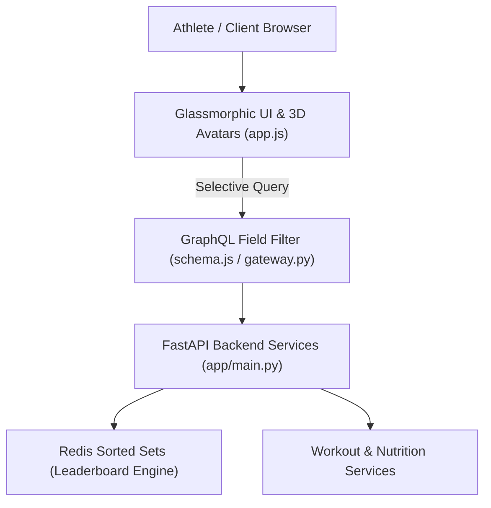

# FitVerse AI — Futuristic Fitness Ecosystem

[](https://github.com/yashpatadiya1724-cmyk/FITVERSEAI/actions/workflows/ci.yml)
[](https://github.com/sponsors/yashpatadiya1724-cmyk)

FitVerse AI is an intelligent fitness platform featuring an interactive futuristic UI, 3D avatar customizer, real-time Redis-powered streak leaderboards, and a GraphQL gateway optimized for low-bandwidth mobile clients.

---

## Key Capabilities

- **Futuristic Glassmorphic Interface:** Immersive HUD dashboard with animated biometric monitors and interactive workout split recommendations.
- **3D Avatar Progression:** Dynamic 3D avatar visualization reflecting strength gains and milestone streaks.
- **Redis Sorted-Set (ZSET) Leaderboards:** Sub-millisecond ranking algorithms tracking user workout consistency, XP multipliers, and community tiers.
- **Optimized GraphQL Gateway:** Field selection filtering that strips unused metadata, delivering over 80% payload reduction on cellular networks.
- **Dual-Stack Testing:** Automated test coverage for both client-side modules and backend API endpoints.

---

## System Architecture



---

## Quickstart Guide

### Prerequisites
- Node.js (version 18 or newer)
- Python 3.10+ (for optional backend services)

### Client Setup
1. Clone the repository:
   ```bash
   git clone https://github.com/yashpatadiya1724-cmyk/FITVERSEAI.git
   cd FITVERSEAI
   ```
2. Start the local development server:
   ```bash
   npm run dev
   ```

### Running Test Suites

- **Client Tests (GraphQL & Redis Leaderboard Engine):**
  ```bash
  npm test
  ```

- **Backend Enterprise Tests:**
  ```bash
  python backend/test_fitverse_enterprise.py
  ```

---

## Maintainer
- Yash Patadiya: [LinkedIn Profile](https://www.linkedin.com/in/yash-patadiya-973161272/)
